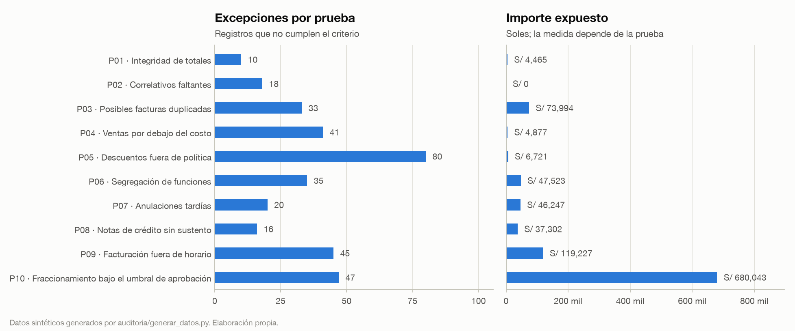
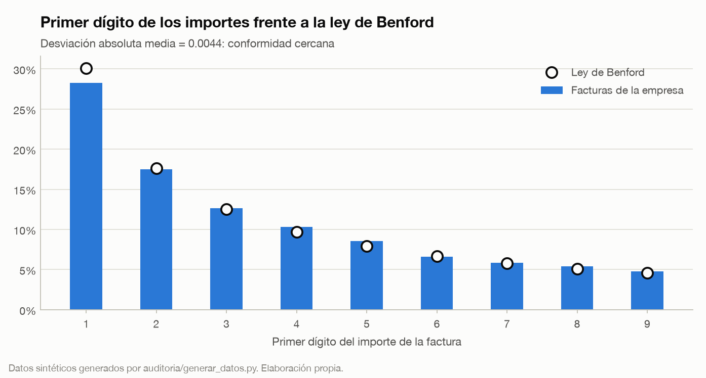

# Analítica de auditoría: ciclo de ventas

[](https://github.com/paolojoveal/auditoria-analitica-ventas/actions/workflows/pruebas.yml)


**¿Qué puede decir un auditor interno sobre el 100% de las ventas de un año antes de pedir un solo documento?**

Diez pruebas de auditoría en SQL sobre el ciclo de ventas de una distribuidora ficticia: 9 095 facturas, 18 477 líneas de detalle y 265 notas de crédito. El proyecto genera los datos, corre las pruebas sobre toda la población (sin muestreo), cuantifica las excepciones y produce lo que entregaría un equipo de auditoría: un informe, papeles de trabajo en Excel y el detalle de cada excepción.



## Las pruebas

Cada prueba es una consulta en [`auditoria/pruebas.sql`](auditoria/pruebas.sql) con su ficha: objetivo, criterio, riesgo y paso de seguimiento.

| | Prueba | Criterio | Técnica SQL | Excepciones | Importe expuesto |
|---|---|---|---|---|---|
| P01 | Integridad de totales | El total de la cabecera es la suma del detalle | `JOIN`, `GROUP BY`, `HAVING` | 10 | S/ 4 465 |
| P02 | Correlativos faltantes | La numeración de cada serie no tiene saltos | CTE recursiva y anti-join | 18 | n. a. |
| P03 | Posibles facturas duplicadas | Mismo cliente e importe en tres días | Self-join con ventana de fechas | 33 | S/ 73 994 |
| P04 | Ventas por debajo del costo | El precio neto no es menor que el costo | Join de tres tablas | 41 | S/ 4 877 |
| P05 | Descuentos fuera de política | 10% libre; hasta 20% con supervisor | `LEFT JOIN` y `CASE` | 80 | S/ 6 721 |
| P06 | Segregación de funciones | Quien registra no aprueba ni anula | `UNION ALL` | 35 | S/ 47 523 |
| P07 | Anulaciones tardías | Solo se anula en el mes de emisión | Funciones de fecha | 20 | S/ 46 247 |
| P08 | Notas de crédito sin sustento | Factura vigente; sin exceder su total | CTE con acumulado y `LEFT JOIN` | 16 | S/ 37 302 |
| P09 | Facturación fuera de horario | Lunes a sábado, de 08:00 a 20:00 | `strftime` | 45 | S/ 119 227 |
| P10 | Fraccionamiento | Desde S/ 10 000 aprueba gerencia | `GROUP BY` con `HAVING` compuesto | 47 | S/ 680 043 |

## Lo que entrega

- **[Informe](resultados/informe.md):** resumen, resultado de cada prueba con sus cinco primeras excepciones y análisis de Benford.
- **[Papeles de trabajo](resultados/papeles_de_trabajo.xlsx):** un libro de Excel con un índice enlazado y una hoja por prueba, con la ficha y todas las excepciones, listas para filtrar.
- **[Excepciones](resultados/excepciones):** un CSV por prueba, con la clave de cada registro para el seguimiento.

## Una excepción no es un hallazgo

Como los datos son sintéticos, el generador anota qué irregularidades sembró. Eso permite medir algo que en una auditoría real no se observa: cuánto detecta cada prueba y cuántas de sus excepciones son falsas alarmas.

| Prueba | Sembradas | Detectadas | Excepciones no sembradas | Precisión |
|---|---|---|---|---|
| P01, P02, P05, P06, P07, P09 | 208 | 208 | 0 | 100% |
| P03 Posibles duplicados | 25 | 25 | 8 | 76% |
| P04 Ventas bajo el costo | 40 | 40 | 1 | 98% |
| P08 Notas de crédito | 15 | 15 | 1 | 94% |
| P10 Fraccionamiento | 30 | 30 | 17 | 64% |

Cuatro lecturas:

1. **Detectar todo lo sembrado es lo esperable, no un mérito.** Las pruebas buscan justo los patrones que el generador siembra. Lo que una prueba no anticipa, no lo encuentra. Con otras semillas la detección baja de 100% en algún caso: un fraccionamiento queda oculto si el mismo cliente tiene ese día otra factura grande ya aprobada.
2. **Las falsas alarmas son parte del trabajo.** Las 8 de P03 son pedidos repetidos legítimos a pocos días; las 17 de P10, clientes que hicieron dos pedidos el mismo día. Ninguna consulta distingue eso: hay que confirmar con el cliente o con la guía de despacho.
3. **Afinar una prueba tiene un costo.** Si P10 exigiera que el mismo usuario registre todas las facturas del día, las falsas alarmas bajarían de 17 a 1, pero se escaparían 7 de los 30 casos sembrados.
4. **Las pruebas se explican entre sí.** Las dos excepciones «no sembradas» de P04 y P08 son reales. La de P04 es una venta bajo el costo causada por un descuento de 25%, fuera de política. La de P08 es una nota de crédito que referencia la factura F002-001083, uno de los 18 correlativos faltantes de P02: evidencia de que ese número sí se emitió y después se eliminó.

En P09, dos usuarios concentran 34 de las 45 facturas fuera de horario (76%). Ese es el tipo de patrón que orienta el seguimiento.

## Ley de Benford



El primer dígito de los importes se ajusta a la ley de Benford: la desviación absoluta media es 0.0044, «conformidad cercana» según los umbrales de Nigrini (2012). El chi-cuadrado, en cambio, rechaza la conformidad al 5% (21.1 frente a un crítico de 15.5). No es una contradicción: con 8 835 facturas, el chi-cuadrado detecta desviaciones demasiado pequeñas para importar, y por eso se lee junto con la desviación absoluta media.

Benford tampoco delata el fraccionamiento sembrado: 60 facturas entre 8 835 no mueven la distribución. Es una herramienta de tamizado, no un detector. La prueba dirigida (P10) sí lo encuentra.

## Cómo correrlo

```bash
git clone https://github.com/paolojoveal/auditoria-analitica-ventas.git
cd auditoria-analitica-ventas
python -m venv .venv && source .venv/bin/activate   # en Windows: .venv\Scripts\activate
pip install -r requirements.txt

python -m auditoria.ejecutar          # audita los datos de datos/ y escribe resultados/
```

Para auditar otra empresa sintética sin tocar los resultados publicados:

```bash
python -m auditoria.ejecutar --semilla 7 --datos otra/datos --salida otra/resultados
```

Las consultas son SQL estándar de SQLite y se pueden correr a mano sobre los CSV de [`datos/`](datos):

```bash
sqlite3 :memory: -cmd ".mode csv" -cmd ".import datos/facturas.csv facturas" \
  "SELECT usuario_registro, COUNT(*) FROM facturas WHERE hora_registro >= '20:00' GROUP BY 1 ORDER BY 2 DESC;"
```

Pruebas automáticas:

```bash
pip install -r requirements-dev.txt
pytest
```

## Cómo se verifica

Las pruebas de auditoría también se prueban ([`tests/`](tests)):

- Detectan todo lo sembrado en la empresa publicada y al menos 90% en otras dos.
- Una empresa generada **sin** irregularidades no produce ninguna excepción en ocho de las diez pruebas. Las otras dos (P03 y P10) marcan solo operaciones legítimas, que es lo que deben marcar.
- El detalle concilia con la cabecera, no hay líneas huérfanas y los totales de la población coinciden con los datos.
- Si se elimina una factura a mano, P02 devuelve exactamente ese número.
- Benford acepta una muestra que cumple la ley y rechaza una con dígitos uniformes.

GitHub Actions corre todo en cada cambio, incluida una auditoría completa sobre una empresa distinta.

## Estructura

```
auditoria/generar_datos.py   Empresa sintética y registro de lo sembrado
auditoria/pruebas.sql        Las diez pruebas, cada una con su ficha
auditoria/ejecutar.py        Carga en SQLite, corre las pruebas, Benford y contraste
auditoria/informe.py         Informe, papeles de trabajo en Excel y figuras
datos/                       Tablas en CSV (y _verdad.csv, que una auditoría real no tiene)
resultados/                  Informe, papeles de trabajo, figuras y excepciones
tests/                       Pruebas automáticas
```

Las políticas contra las que se audita (límites de descuento, umbral de aprobación, horario) están al inicio de [`generar_datos.py`](auditoria/generar_datos.py).

## Límites

- **Todo es sintético.** La empresa, los clientes y los importes no existen. Las irregularidades tienen la forma de las que se buscan en la práctica, pero su frecuencia la decidí yo.
- **Las pruebas verifican atributos de los registros.** No reemplazan la confirmación con clientes, la revisión de documentos ni el recorrido del proceso con sus responsables.
- **El importe expuesto no es una pérdida.** Su significado cambia con la prueba (la pérdida frente al costo en P04, el total de la factura en P09) y por eso los importes no se suman entre pruebas.
- Un correlativo faltante al final de una serie no es detectable: no hay un número posterior que lo delate.
- Causa, efecto y recomendación salen del seguimiento de cada excepción, no de la consulta. El informe no los inventa.

## Referencias

- Committee of Sponsoring Organizations of the Treadway Commission (2013). *Internal Control: Integrated Framework*.
- The Institute of Internal Auditors (2024). *Global Internal Audit Standards*.
- Nigrini, M. (2012). *Benford's Law: Applications for Forensic Accounting, Auditing, and Fraud Detection*. Wiley.

## Sobre mí

**Paolo Jove** · Estudiante de 8.º semestre (por iniciar el 9.º) en la **Pontificia Universidad Católica del Perú (PUCP)**. Más proyectos en [portafolio-finanzas](https://github.com/paolojoveal/portafolio-finanzas).

[LinkedIn](https://www.linkedin.com/in/paolo-jove-085647127)

---

<sub>© 2026 Paolo Jove. Todos los derechos reservados.</sub>
